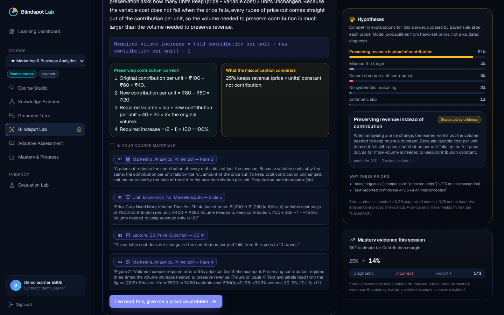
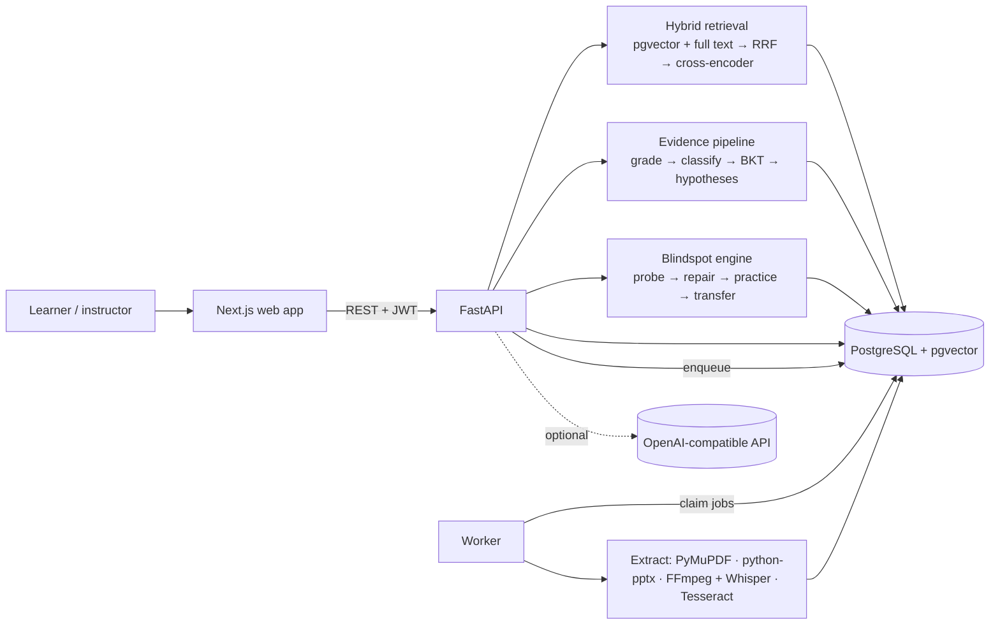
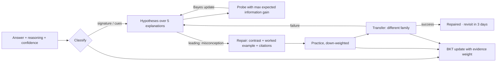

# Blindspot Lab

**Understand what you don't understand.**

Blindspot Lab turns a course's lecture videos, textbooks and slide decks into a source-cited knowledge base, then uses it to find out *why* a learner gets something wrong: it treats a wrong answer as competing hypotheses, asks one discriminating follow-up question, repairs the specific misconception with explanations cited to the exact page, slide or timestamp, and checks with a structurally different transfer problem whether the understanding actually moved. Every answer updates an inspectable, evidence-weighted learner model.

Built for the **Multimodal AI Hackathon 2026, Track D: Personalized Tutoring & Adaptive Learning**. Everything runs locally on CPU with open models; an OpenAI-compatible API is optional.



---

## 1. Product overview

| Page | What it does |
|---|---|
| **Learning Dashboard** | Courses, next recommended activity with its reason, concept mastery, open misconception hypotheses, recent evidence. |
| **Course Studio** | Upload PDF / PPTX / MP4; live job status (*Uploaded → Extracting → Indexing → Ready*); extracted units by type; processing and privacy mode. |
| **Knowledge Explorer** | Interactive topic → concept → sub-concept graph with prerequisite arrows (origin, confidence, review status), concept detail with tagged source passages; instructors can approve, reject or add edges (cycles are refused). |
| **Grounded Tutor** | Answers only from the course's sources with citation chips that open the exact page, slide or video timestamp; declines off-material questions; outside knowledge only in a separately labelled field; shows the learner model's view of the concepts discussed and a scored knowledge check. |
| **Blindspot Lab** | The diagnosis-and-repair loop, including the signature *contribution-margin price-cut* scenario. |
| **Adaptive Assessment** | Diagnostic check-in, adaptive practice, spaced review, mock exam; MCQ, numerical and short-answer; scope chosen by the learner; cited feedback per answer and a post-assessment report. |
| **Mastery & Progress** | BKT estimates with evidence quality and review dates, trajectory, sessions, accuracy, misconception evidence trail, and the method with its formulas. |
| **Evaluation Lab** | Recorded evaluation runs with case-level results, methods and limitations; new runs can be queued. |
| **Source viewer** | PDF page with the cited text highlighted, rendered slide, or video at the cited sentence with its transcript. |

## 2. Problem and user impact

A learner can recall *contribution margin = price − variable cost* and still answer a pricing question as if revenue were what mattered. Scores, chatbots and generic quiz generators do not tell the learner (or the instructor) which misunderstanding produced the error, whether it was a slip, or whether a later correct answer reflects real understanding. Blindspot Lab is built for business and analytics courses where that gap is common: it separates sound reasoning from lucky answers, slips from misconceptions, and repair from repetition, and every claim it makes points back to the course material.

## 3. Core differentiation

* **Diagnosis before explanation.** A wrong answer opens a probability distribution over five explanations (misconception, calculation error, misread question, missing prerequisite, guess). The follow-up probe is the one with the highest expected information gain. A hypothesis is *suspected* or *supported by evidence*, never "confirmed".
* **Repair that is checked.** Contrastive explanation on the learner's own numbers, cited to the sources, then practice, then a transfer problem from a different question family. Only transfer success moves the hypothesis to *repaired, revisit pending*.
* **Evidence-weighted mastery.** Repeated paraphrases, scaffolded practice and lucky answers with flawed reasoning count for less; probe answers count for nothing. Every update is stored and explained.
* **Source fidelity.** Exact page/slide/sentence-level timestamp provenance, verified answer keys (independent plug-back), refusal when the material is silent.

## 4. Competition track alignment

| Track D requirement | Implementation | Verified by |
|---|---|---|
| Ingest videos, textbooks, slides without preprocessing | `services/api/app/services/ingestion/{pdf,pptx,video}.py`, worker queue | integration tests `test_ingestion.py`, e2e upload spec |
| Topics, concepts, prerequisites; every unit linked to page/slide/timestamp; every unit tagged | `knowledge/build.py`, DB anchor constraint | 67/67 units tagged; `test_knowledge_graph_is_acyclic_and_covers_units` |
| Information from images, diagrams, figures | figure OCR + captions, native PPTX chart data, optional vision descriptions | `test_pdf_units_have_pages_tables_and_figures`, `test_pptx_units_have_slides_notes_and_chart`; RAG *diagram* cases |
| Cited answers opening the exact location | `tutor/grounded.py`, `tutor/citations.py`, source viewer | e2e step 4; citation-location metrics |
| Decline / flag unsupported queries; separate outside knowledge | grounding gate, labelled `external_content` | 16/16 off-material refusals; `test_tutor_grounded_answer_cites_sources_and_refuses_off_topic` |
| Quizzes and mock exams (MCQ, short, numerical) on chosen scope, tagged topic/source/difficulty | `assessment/{templates,supply,selection,sessions}.py` | e2e step 6; assessment run |
| Verified correctness; no repeated questions | `assessment/{verification,plugback}.py`, exposures | 64/64 plug-back, 12/12 flawed drafts caught; 0% exact repeats |
| Cited feedback; report with weak topics and misconceptions | `learning/attempts.py`, `sessions.py` | `test_diagnostic_assessment_persists_attempts_and_mastery` |
| Per-topic mastery updated after quizzes and conversations | `learner/{bkt,mastery}.py`; tutor knowledge check | trajectory chart; integration tests |
| New students: diagnostic | recommender rule 1, diagnostic assessment | e2e steps 1 and 6 |
| Framework-based RAG evaluation (faithfulness, answer relevancy, context precision/recall) on a team-built test set | RAGAS 0.4.3 non-LLM context metrics; LLM-judge metrics when a key is set (otherwise *unavailable*) plus labelled judge-free substitutes | `evaluation/results/RESULTS.md` |
| Simulated students over multiple sessions: mastery gains, repetition rate | `evaluation/personalization.py` | paired results with bootstrap intervals |
| Optional: course flow map | Knowledge Explorer | e2e step 3 |

## 5. Features

Multimodal ingestion with provenance · figure and chart extraction · concept graph with editable prerequisites · hybrid retrieval with reranking · extractive grounded tutor (generative mode optional) with deep-linked citations and refusal · learner-state context in the tutor · 19 parametric question templates + a 33-item bank, verification and novelty control · numeric/MCQ/rubric grading · seven-way error classification · Bayesian hypothesis tracking with information-gain probes · cited repair, practice, transfer and revisit · evidence-weighted BKT · recommender with written rationales · analytics · evaluation harness with case-level inspection · one-click synthetic demo learners.

## 6. Architecture





Details: [docs/ARCHITECTURE.md](docs/ARCHITECTURE.md).

## 7. Technology stack

* **Web:** Next.js 15 (App Router), React 19, TypeScript, Tailwind CSS 4, Radix primitives, TanStack Query, React Hook Form + Zod, Recharts, React Flow (`@xyflow/react`), react-pdf, react-markdown, Lucide.
* **API / worker:** Python 3.13, FastAPI, Pydantic 2, SQLAlchemy 2, Alembic, structlog.
* **Data:** PostgreSQL 16 + pgvector (HNSW), PostgreSQL full-text search; local disk or Supabase storage.
* **Local AI:** `BAAI/bge-small-en-v1.5` embeddings (fastembed), `ms-marco-MiniLM-L-6-v2` cross-encoder (ONNX), `faster-whisper base.en`, Tesseract OCR, `nli-deberta-v3-xsmall` (evaluation).
* **Optional:** any OpenAI-compatible chat, vision, embedding and transcription endpoints.
* **Quality:** pytest, Vitest, Playwright, Ruff, GitHub Actions, RAGAS 0.4.3.

## 8. Multimodal ingestion pipeline

PDF → page-anchored text chunks (heading-aware), Markdown tables, figures (caption + OCR, bbox, image), OCR for image-only pages. PPTX → slide text, tables, **native chart series**, picture OCR, speaker notes, rendered previews. Video → FFmpeg audio, scene-change keyframes with OCR, Whisper transcription biased with the on-screen vocabulary and split into **sentence-level timestamps** from word timings. Units are chunked (50–170 words), embedded and indexed; the knowledge build then activates catalogue concepts supported by the sources, derives structural concepts, tags every unit, proposes acyclic prerequisites and builds the verified question pool. → [docs/INGESTION_AND_GROUNDING.md](docs/INGESTION_AND_GROUNDING.md)

## 9. Source grounding and citation method

Hybrid retrieval (vector + full text, reciprocal-rank fusion, cross-encoder rerank, source-type hints) → grounding gate (best reranker logit ≥ −0.85 plus term coverage when the evidence is weak) → **local mode** quotes the most relevant sentences verbatim (tables and charts whole) with `[S1]` markers; **generative mode** must return cited passage ids, and answers without a valid citation are withheld. Off-material questions get an explicit refusal plus the nearest passages, labelled as not an answer. Each citation deep-links to the page (text highlighted), slide, or video sentence.

## 10. Misconception diagnosis methodology

A team-written catalogue of 10 domain misconceptions (cues, competing interpretations, probes with likelihood tables, repair templates), activated per course only when the sources support it. Classification from signature answers, near-miss patterns, reasoning cues, confidence and weak prerequisites gives a prior over five explanations; the expected-information-gain probe updates it by Bayes' rule; status thresholds require ≥ 0.75 *and* two independent pieces of evidence for *supported*; learner-level evidence accumulates as odds updates with stated likelihood ratios. → [docs/MASTERY_AND_MISCONCEPTIONS.md](docs/MASTERY_AND_MISCONCEPTIONS.md)

## 11. Adaptive learner-model methodology

Per-concept Bayesian Knowledge Tracing (P(L₀) 0.25, T 0.10, guess by type, slip by difficulty) with an evidence weight that tempers the likelihoods (repeat family ×0.5ᵏ, identical item ×0.3, scaffolded practice ×0.6, questionable reasoning ×0.4, review-flagged grading 0). Review dates from the estimate (12 h to 7 days), interleaving after 12 answers elsewhere. A rule-based recommender (diagnostic → investigate → prerequisite first → targeted practice → review → assess → mock exam) explains each recommendation. Tutor answers report the learner's state for the concepts discussed and suggest the next step.

## 12. Evaluation procedure and actual results

Full method: [docs/EVALUATION.md](docs/EVALUATION.md). Generated results: [evaluation/results/RESULTS.md](evaluation/results/RESULTS.md). Final recorded runs, local mode, on the synthetic demo course:

| Retrieval & grounding (RAGAS 0.4.3 + pipeline metrics) | Benchmark (49) | Held-out (15) |
|---|---|---|
| Context precision / recall | 91.0% / 67.9% | 86.4% / 68.5% |
| Faithfulness / answer relevancy, RAGAS LLM judge | unavailable (no judge model) | unavailable |
| Faithfulness, local NLI substitute (≈100% by construction for verbatim quotes) | 99.3% | 100.0% |
| Answer relevancy, embedding substitute | 79.8% | 80.5% |
| Citation-location accuracy · answers with a correct citation | 83.8% · 100.0% | 88.3% · 90.9% |
| Answer coverage · off-material refusal accuracy | 100.0% · 100% (12/12) | 90.9% · 100% (4/4) |

Ingestion: 100% page and slide coverage, every unit anchored, lecture transcript WER 9.1%. Assessment: 97/97 pool questions verified, 64/64 computed keys pass plug-back, 12/12 flawed drafts caught with 0/6 sound drafts rejected, numeric grading 17/18, short-answer rubric 14/15 (20% flagged for review), 0% exact repeats over six adaptive assessments vs 17.6% for random selection.

Simulated learners (15 per profile, paired adaptive − random-quiz differences, 95% bootstrap intervals): held-out post-test **+17.6 pp [+6.7, +28.1]** for the mixed-misconception profile, +3.3 pp [−6.2, +13.8] for strong learners and +11.4 pp [−1.9, +23.8] for weak-prerequisite learners; exact repeats −15.7 to −18.7 pp for every profile; misconceptions resolved +24.4 pp [+6.5, +42.9] for weak-prerequisite learners. Mastery calibration is **worse** than the baseline arm (Brier +0.05 to +0.10). These are simulations under hand-set assumptions, not evidence about real students.

## 13. Installation and configuration

Prerequisites: Python 3.12+ (3.13 tested), Node 20+ (22 tested), PostgreSQL 16 with pgvector, Tesseract, FFmpeg; LibreOffice for slide previews (optional); [uv](https://docs.astral.sh/uv/) or pip. Or just Docker.

```bash
git clone https://github.com/arjunjustforai-ux/blindspot-lab.git && cd blindspot-lab
cp .env.example .env        # set JWT_SECRET; adjust DATABASE_URL; optional OPENAI_API_KEY + LLM_PROVIDER=openai
scripts/setup.sh            # Python env, migrations, model download, demo course ingestion, web deps
```

Every variable is documented in [.env.example](.env.example). No paid service is required.

## 14. Running locally

```bash
scripts/start_dev.sh        # API on :8000 (worker in-process), web on :3000
# or
docker compose up --build   # Postgres + pgvector, API, worker, web
```

Tests: `scripts/run_tests.sh` (lint, 151 unit + 15 integration tests, typecheck, Vitest) and `cd tests/e2e && npx playwright test` (9 browser tests; app must be running).

## 15. Demo instructions

Open http://localhost:3000 → **Explore the demo course** (creates a labelled synthetic learner) → Blindspot Lab → **Start the scenario** → **Fill in the scripted learner's answer** → submit → use the scripted probe response → read the cited repair → continue through practice and transfer → open Mastery & Progress. Step-by-step: [docs/DEMO_GUIDE.md](docs/DEMO_GUIDE.md). Screenshots of every step: [docs/screenshots](docs/screenshots).

## 16. Deployment instructions

Prepared, not yet deployed: Docker images for API/worker and web, `docker-compose.yml`, a Render blueprint (`render.yaml`), Railway configs (`deploy/railway`), Vercel config (`apps/web/vercel.json`), health checks (`/api/health`, `/api/ready`), CORS and storage settings. → [docs/DEPLOYMENT.md](docs/DEPLOYMENT.md)

## 17. Security and limitations

Bcrypt passwords, JWT with production secret checks, course-membership checks on every resource, signed expiring media URLs, upload validation (type, size, magic bytes, de-duplication), prompt-injection screening of extracted text, no raw HTML rendering, secrets only in environment variables, audit log of every model call. Main limitations: no real-student validation; hand-set parameters and a team-written misconception catalogue; small self-authored benchmarks; local mode quotes rather than explains; generative paths and Supabase storage untested without credentials; not deployed. Full list: [docs/LIMITATIONS.md](docs/LIMITATIONS.md).

## 18. AI-assistance disclosure

* **Development.** The code, tests, documentation and the demo course materials in this repository were produced with an AI coding assistant (Claude Code) working under the team's direction; commits carry a co-author trailer. The team is responsible for reviewing it.
* **Runtime.** By default the product uses only local open models (listed in §7) and sends no course content to external providers. When an OpenAI-compatible API is configured, it is used for generative answers, question drafting/verification, figure descriptions, short-answer grading and the RAGAS judge metrics; the UI and `/api/ready` show the active mode, and generated content is labelled.
* **Demo material.** The course content (primer, slides, lecture script, question bank, figures) is original synthetic material with fictional companies and numbers, written for this project with AI assistance; the lecture narration is synthesised speech (Piper TTS).

## 19. Contributors

Team members (real full names, as registered on Devpost): *to be completed by the team before submission.* Repository: [arjunjustforai-ux/blindspot-lab](https://github.com/arjunjustforai-ux/blindspot-lab).

## 20. Dataset and software attributions

**Data.** No external datasets. The demo course, question bank, benchmarks and misconception catalogue were created for this project.

**Models.** BAAI/bge-small-en-v1.5 (MIT) · cross-encoder/ms-marco-MiniLM-L-6-v2 (Apache-2.0; ONNX export by Xenova) · OpenAI Whisper weights via faster-whisper / CTranslate2 (MIT) · cross-encoder/nli-deberta-v3-xsmall (Apache-2.0) · Piper voice en_US-lessac-medium (see its model card; used only to build the demo video).

**Software.** FastAPI, Pydantic, SQLAlchemy, Alembic, Uvicorn, structlog, pgvector, psycopg (LGPL-3.0), python-pptx, faster-whisper, fastembed, ONNX Runtime, RapidFuzz, NumPy, Pillow, pytesseract, Tesseract OCR (Apache-2.0), FFmpeg (LGPL/GPL), LibreOffice (MPL-2.0), RAGAS (Apache-2.0), LangChain (MIT), Matplotlib, ReportLab (BSD), Piper (MIT); Next.js, React, Tailwind CSS, Radix UI, TanStack Query, React Hook Form, Zod, Recharts, React Flow, react-pdf / PDF.js (Apache-2.0), react-markdown, Lucide (ISC), Sonner, Geist font (OFL-1.1); pytest, Vitest, Playwright (Apache-2.0), Ruff. **PyMuPDF is licensed under AGPL-3.0** (or a commercial licence from Artifex): offering Blindspot Lab as a network service requires complying with the AGPL for the deployed source, or replacing or licensing that dependency.

Blindspot Lab itself is released under the [MIT License](LICENSE).
