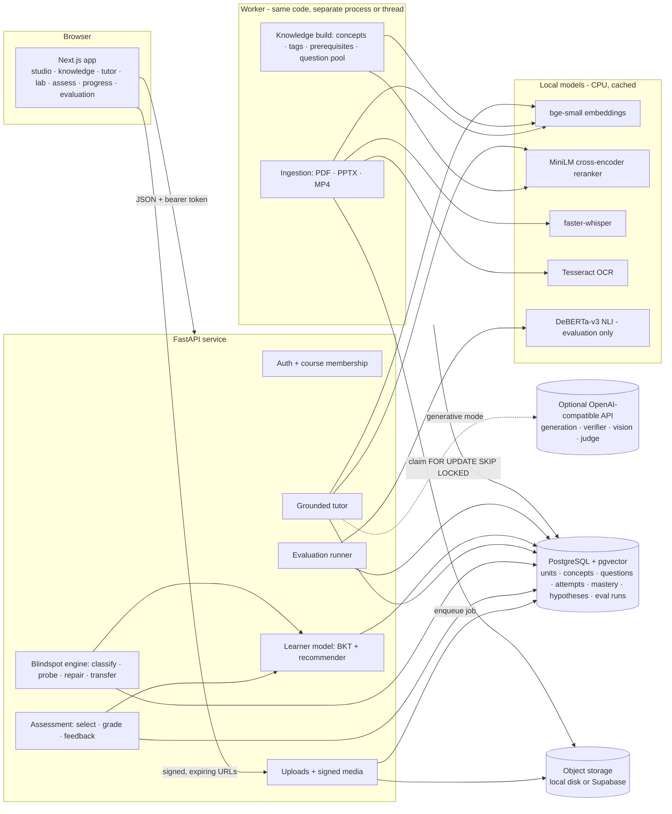

# Architecture

Blindspot Lab is a monorepo with three runtime pieces and one database:

| Piece | Path | Role |
|---|---|---|
| Web app | `apps/web` | Next.js 15 (App Router, TypeScript, Tailwind 4). Talks to the API with a bearer token. |
| API | `services/api/app` | FastAPI + SQLAlchemy 2. Auth, courses, uploads, retrieval, tutor, assessment, learner model, diagnosis, analytics, evaluation. |
| Worker | `services/api/app/worker.py` (deployed via `services/worker`) | Durable job queue in PostgreSQL: ingestion, knowledge rebuild, queued evaluation runs. Runs in-process with the API or as its own service. |
| Database | `database/migrations` | PostgreSQL 16 + pgvector. Alembic migrations. Vectors, full-text indexes and all learner evidence live here. |

## Request paths

**Upload → ready.** `POST /api/courses/{id}/sources` validates extension, size and magic bytes, de-duplicates by SHA-256, stores the file and inserts an `ingestion_jobs` row (`queued`). The worker claims it (`FOR UPDATE SKIP LOCKED`), runs the modality extractor, chunks, embeds and writes `content_units` with their page / slide / timestamp anchor, then queues `rebuild_knowledge`. The studio polls `/jobs` and shows *Uploaded → Extracting → Indexing → Ready* from the real job state. Failures keep their error message and can be retried; a worker that dies leaves a stale `running` job that is re-queued after 45 minutes.

**Question → grounded answer.** `POST /api/conversations/{id}/messages` → hybrid retrieval scoped to the course → grounding gate → extractive composer (default) or a cited generative answer (when a model is configured) → citations with deep links → `learner_context` (the learner model's view of the concepts discussed) → persisted message. See [INGESTION_AND_GROUNDING.md](INGESTION_AND_GROUNDING.md).

**Answer → evidence.** Every scored answer (assessment, tutor knowledge check, Blindspot session) goes through one pipeline, `services/learning/attempts.py`: grade → classify the error → persist the attempt → evidence-weighted BKT update → misconception evidence (odds update) → cited feedback. See [MASTERY_AND_MISCONCEPTIONS.md](MASTERY_AND_MISCONCEPTIONS.md).

## Data model (main tables)

| Area | Tables |
|---|---|
| Identity & courses | `users`, `courses`, `course_memberships` (owner / instructor / student) |
| Sources | `source_files`, `ingestion_jobs`, `content_units` (text, `vector(384)`, generated `tsvector`, page / slide / start–end seconds, bbox, image key, extraction metadata) |
| Knowledge | `concepts` (topic / concept / sub-concept, origin, review status), `concept_prerequisites` (origin, confidence, rationale, review status), `concept_sources` (unit ↔ concept tags with method and relevance) |
| Assessment | `questions` (type, difficulty, key, tolerance, rubric, signatures, family, verification report), `question_sources`, `assessments`, `assessment_items` (with selection reason), `question_exposures`, `question_attempts` |
| Learner model | `mastery_states`, `mastery_history` (every update: before, after, evidence weight, source) |
| Diagnosis | `misconception_definitions`, `course_misconceptions`, `diagnostic_sessions`, `diagnostic_probes`, `misconception_hypotheses`, `misconception_evidence`, `learning_interventions` |
| Tutor | `conversations`, `tutor_messages` (citations, grounding status, learner context) |
| Evaluation & audit | `evaluation_cases`, `evaluation_runs`, `evaluation_results`, `ai_operation_logs` |

A database constraint requires every content unit to carry at least one anchor (page, slide or timestamp).

## Design decisions

* **PostgreSQL for everything.** Vectors (pgvector HNSW), full-text search (GIN on a generated `tsvector`), the job queue and the learner evidence share one transactional store. Fewer moving parts for a small team and a cheap deployment; no separate vector database or broker.
* **Local-first AI.** Embeddings, reranking, speech-to-text, OCR and evaluation NLI run on CPU from cached open models, so the full product works without paid APIs and course content never leaves the server. An OpenAI-compatible endpoint is optional and adds generative answers, a blind verifier pass for generated questions, figure descriptions and the RAGAS LLM-judge metrics. The UI and `/api/ready` always state which mode is active.
* **Deterministic where correctness matters.** Answer keys for computed questions come from parametric templates and are checked by independent plug-back; numeric grading is tolerance-based; misconception inference is explicit Bayesian bookkeeping over a reviewable catalogue. Models are used for retrieval, ranking and language, not to decide whether an answer is right.
* **One evidence pipeline.** All scored interactions share grading, classification, weighting and persistence, so analytics and recommendations see the same evidence the learner saw.
* **Auditable AI calls.** Every model call (local or remote) is logged in `ai_operation_logs` with operation, model, prompt version, latency and status; evaluation runs record dataset version, models and seed.

## Security

* Passwords hashed with bcrypt; JWT (HS256, issuer-checked) bearer tokens; production refuses a default or short `JWT_SECRET`. Optional Supabase JWT verification when `SUPABASE_JWT_SECRET` is set.
* Every course resource is checked against `course_memberships`; only owners and instructors can upload, delete, re-index or edit the knowledge graph.
* Media are served through HMAC-signed, expiring URLs, and membership is re-checked on every media request.
* Uploads: extension allow-list, size limits, magic-byte check, SHA-256 de-duplication; the original file name is never used as a storage path.
* Uploaded content is treated as untrusted: extracted text is screened for prompt-injection phrasing (flagged in unit metadata), and model prompts wrap sources in an explicit "data, not instructions" notice. Markdown from the API is rendered without raw HTML.
* Secrets come only from environment variables (`.env` is git-ignored; `.env.example` documents every variable).
