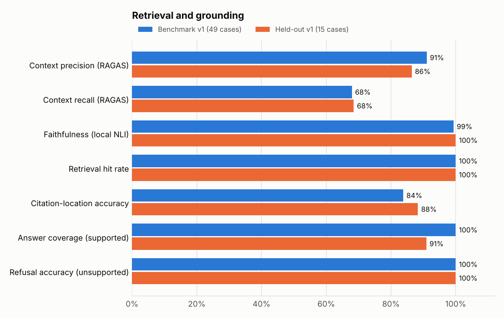
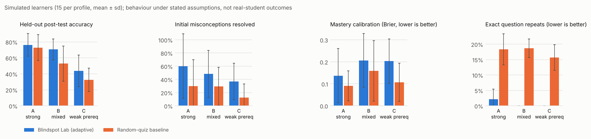

# Evaluation results

Generated by `evaluation/scripts/make_report.py` from the latest recorded runs in this folder. Re-run with `python evaluation/scripts/run_evaluation.py` then this script. Methodology and caveats: [docs/EVALUATION.md](../../docs/EVALUATION.md).

## 1. Retrieval, grounding and citations

- Run `bc8674bc-c881-4f05-9d41-725cf4e0391c` finished 2026-10-12T01:07:07.440470+00:00; dataset `rag_benchmark` v1
- Models: reranker: `local:Xenova/ms-marco-MiniLM-L-6-v2`, embedding: `local:BAAI/bge-small-en-v1.5`, transcription: `local:base.en`
- Case-level results: `rag_20261012T010707.json`

Benchmark: 49 cases (37 answerable, 12 off-material). Held-out: 15 cases written after the pipeline was frozen (the less biased estimate).

| Metric | Benchmark | Held-out | Framework / note |
|---|---|---|---|
| Context precision | 91.0% | 86.4% | RAGAS 0.4.3 · NonLLMContextPrecisionWithReference |
| Context recall | 67.9% | 68.5% | RAGAS 0.4.3 · NonLLMContextRecall |
| Faithfulness (LLM judge) | unavailable | unavailable | No judge LLM configured (LLM_PROVIDER=local) |
| Answer relevancy (LLM judge) | unavailable | unavailable | No judge LLM configured (LLM_PROVIDER=local) |
| Faithfulness (local NLI substitute) | 99.3% | 100.0% | share of answer statements entailed by cited contexts (local NLI cross-encoder, threshold 0.5) |
| Answer relevancy (embedding substitute) | 79.8% | 80.5% | cosine(question, answer) with bge-small embeddings |
| Retrieval hit rate @k | 100.0% | 100.0% |  |
| MRR @k | 100.0% | 100.0% |  |
| Source recall @k | 99.3% | 100.0% |  |
| Citation-location accuracy | 83.8% | 88.3% |  |
| Answers citing a correct location | 100.0% | 90.9% |  |
| Answer coverage on supported questions | 100.0% | 90.9% |  |
| False refusal rate (lower is better) | 0.0% | 9.1% |  |
| Refusal accuracy on unsupported questions | 100.0% | 100.0% |  |

Pass rate by category (benchmark): citation challenge 4/4, diagram 6/6, factual 17/17, multi source 4/4, numerical 6/6, unsupported 12/12

### Run history

| Run (finished, UTC) | Set | citation-location acc. | answers w/ correct citation | context precision | context recall | answer coverage | refusal accuracy |
|---|---|---|---|---|---|---|---|
| `2f367559` 2026-10-12T00:51 | benchmark | 76.1% | 89.2% | 88.0% | 68.2% | 100.0% | 100.0% |
| `2f367559` 2026-10-12T00:51 | held-out | 85.0% | 81.8% | 87.4% | 70.3% | 90.9% | 100.0% |
| `bc8674bc` 2026-10-12T01:07 | benchmark | 83.8% | 100.0% | 91.0% | 67.9% | 100.0% | 100.0% |
| `bc8674bc` 2026-10-12T01:07 | held-out | 88.3% | 90.9% | 86.4% | 68.5% | 90.9% | 100.0% |

Changes between runs are listed in docs/EVALUATION.md.

### Ingestion quality

| Source | Check | Value |
|---|---|---|
| Unit_Economics_for_Marketers.pptx | slide coverage | 100.0% |
| Lecture_03_Price_Cuts.mp4 | video span coverage | 100.0% |
| Lecture_03_Price_Cuts.mp4 | asr wer | 9.1% |
| Lecture_03_Price_Cuts.mp4 | transcription model | `faster-whisper:base.en` (351 reference words) |
| Marketing_Analytics_Primer.pdf | page coverage | 100.0% |
| all | units with page/slide/timestamp provenance | 100.0% |

Limitations recorded with this run:

- Small, self-authored benchmark on a self-authored synthetic course; results describe this pipeline on this material, not general performance.
- RAGAS LLM-judge metrics (faithfulness, answer relevancy) need a configured judge model; in local mode they are reported as unavailable and judge-free substitutes are shown and labelled as such.
- Faithfulness of the local extractive answer mode is high by construction (answers are verbatim quotes); the NLI check verifies that, it does not show that the selected quotes fully answer the question.
- rag_benchmark_v1 was used while fixing pipeline issues; rag_holdout_v1 was written after freezing the pipeline and is the less biased estimate.
- Video locations are annotated from the planned narration timing (±3 s tolerance), not hand-checked against every Whisper segment.

## 2. Assessment quality

- Run `3eb45a8b-4a40-4cb6-b984-760694283f39` finished 2026-10-12T00:51:48.543285+00:00; dataset `question_verification+grading` v1; seed 7
- Models: reranker: `local:Xenova/ms-marco-MiniLM-L-6-v2`, embedding: `local:BAAI/bge-small-en-v1.5`, transcription: `local:base.en`
- Case-level results: `assessment_20261012T005148.json`

| Check | Result |
|---|---|
| Generated questions passing verification | 97/97 (100.0%) |
| Computed answer keys passing independent plug-back | 100.0% of 64 |
| Verifier: deliberately flawed drafts caught | 100.0% of 12 |
| Verifier: sound drafts wrongly rejected | 0.0% of 6 |
| Cited source tagged to the question's concept | 99.0% |
| Numerical grading accuracy (labelled responses) | 94.4% of 18 |
| Short-answer grading accuracy (local rubric) | 93.3% of 15; 20.0% flagged |
| Exact repeats across 6 adaptive assessments | 0.0% (uniform random: 17.6%) |

Pool composition: numerical 63, mcq 29, short_answer 5; difficulty 1: 25, 2: 54, 3: 18.

Limitations recorded with this run:

- Bank answer keys are author-provided; the adversarial set tests the verifier's checks, not every key.
- Short-answer grading in local mode is a transparent keyword + embedding rubric scorer; it is weaker than an LLM or human grader and flags borderline answers for review.
- Repetition is measured for one simulated learner over six assessments.

## 3. Personalization (simulated learners)

- Run `cc2270df-eeac-4c31-8776-58e619d778d1` finished 2026-10-12T01:02:50.869456+00:00; dataset `simulated_learners` v1; seed 2026
- Models: reranker: `local:Xenova/ms-marco-MiniLM-L-6-v2`, embedding: `local:BAAI/bge-small-en-v1.5`, transcription: `local:base.en`
- Case-level results: `personalization_20261012T010250.json`

15 simulated learners per profile, 14 held-out post-test items, same interaction budget for both arms. **These are simulations under hand-set assumptions, not evidence of learning gains for real students.**

| Metric | A_strong adaptive | A_strong baseline | B_mixed adaptive | B_mixed baseline | C_weak_prereq adaptive | C_weak_prereq baseline |
|---|---|---|---|---|---|---|
| post test accuracy | 76.2% ± 14.2 | 72.9% ± 16.1 | 70.5% ± 13.0 | 52.9% ± 21.9 | 43.8% ± 19.8 | 32.4% ± 14.7 |
| retention accuracy | 72.9% ± 15.2 | 70.5% ± 15.4 | 64.8% ± 17.2 | 57.6% ± 13.2 | 42.4% ± 21.9 | 26.7% ± 19.1 |
| misconceptions resolved rate | 60.0% ± 49.0 | 30.0% ± 40.0 | 48.3% ± 35.7 | 29.6% ± 28.9 | 36.9% ± 27.6 | 12.5% ± 20.6 |
| true known end | 84.4% ± 15.5 | 76.7% ± 18.1 | 81.1% ± 16.0 | 68.9% ± 14.7 | 46.7% ± 30.6 | 28.9% ± 22.3 |
| mastery brier | 0.14 ± 0.12 | 0.09 ± 0.07 | 0.21 ± 0.12 | 0.16 ± 0.14 | 0.20 ± 0.10 | 0.11 ± 0.09 |
| weak concept identification accuracy | 85.6% ± 16.0 | 90.0% ± 8.2 | 72.2% ± 19.9 | 77.8% ± 19.9 | 64.4% ± 14.7 | 86.7% ± 13.9 |
| gap precision | 44.4% ± 49.7 | 40.0% ± 43.6 | 90.5% ± 18.6 | 90.6% ± 13.9 | 68.9% ± 29.1 | 57.8% ± 23.5 |
| gap recall | 70.0% ± 40.0 | 100.0% ± 0.0 | 54.6% ± 31.2 | 83.7% ± 20.8 | 81.5% ± 22.3 | 91.7% ± 16.4 |
| exact repeat rate | 2.2% ± 3.3 | 18.3% ± 5.1 | 0.0% ± 0.0 | 18.7% ± 3.0 | 0.0% ± 0.0 | 15.7% ± 4.1 |
| family repeat rate | 34.6% ± 18.9 | 37.7% ± 5.0 | 43.6% ± 15.9 | 38.7% ± 4.0 | 41.4% ± 13.0 | 37.5% ± 5.3 |
| targeting precision | 80.0% ± 28.3 | — | 60.2% ± 34.9 | — | 90.8% ± 20.6 | — |
| blindspot sessions | 0.80 ± 1.72 | 0.00 ± 0.00 | 3.60 ± 2.58 | 0.00 ± 0.00 | 2.00 ± 1.41 | 0.00 ± 0.00 |
| probes | 0.13 ± 0.50 | 0.00 ± 0.00 | 1.93 ± 1.39 | 0.00 ± 0.00 | 1.33 ± 1.49 | 0.00 ± 0.00 |

### Paired differences (adaptive − baseline)

Each simulated learner is run through both arms with the same hidden state, so differences are paired. Mean difference with a 95% percentile bootstrap interval (10,000 resamples of learners, seed 7); an interval that excludes 0 indicates a consistent difference under the simulation's assumptions.

| Metric | A_strong | B_mixed | C_weak_prereq |
|---|---|---|---|
| Held-out post-test accuracy | +3.3 pp [-6.2 pp, +13.8 pp] (n=15) | +17.6 pp [+6.7 pp, +28.1 pp] (n=15) | +11.4 pp [-1.9 pp, +23.8 pp] (n=15) |
| Retention accuracy | +2.4 pp [-8.1 pp, +13.8 pp] (n=15) | +7.1 pp [-0.5 pp, +14.3 pp] (n=15) | +15.7 pp [+0.0 pp, +28.6 pp] (n=15) |
| Concepts truly known: gain (end − start) | +7.8 pp [-1.1 pp, +17.8 pp] (n=15) | +12.2 pp [+4.4 pp, +20.0 pp] (n=15) | +17.8 pp [-1.1 pp, +33.3 pp] (n=15) |
| Initial misconceptions resolved | +30.0 pp [+0.0 pp, +70.0 pp] (n=5) | +18.8 pp [-7.3 pp, +43.7 pp] (n=15) | +24.4 pp [+6.5 pp, +42.9 pp] (n=14) |
| Mastery calibration, Brier (negative = adaptive better) | +0.047 [-0.024, +0.115] (n=15) | +0.048 [-0.070, +0.156] (n=15) | +0.096 [+0.032, +0.166] (n=15) |
| Exact question repeats (negative = adaptive better) | -16.2 pp [-19.2 pp, -13.0 pp] (n=15) | -18.7 pp [-20.0 pp, -17.0 pp] (n=15) | -15.7 pp [-17.8 pp, -13.5 pp] (n=15) |

Profiles: `A_strong` Learner A: strong baseline knowledge; `B_mixed` Learner B: mixed understanding with selected misconceptions; `C_weak_prereq` Learner C: weak prerequisite knowledge.

Simulation assumptions:

- slip: 0.1
- slip per difficulty: 0.03
- mcq guess: uniform over options
- numeric guess: 0.05
- p signature answer if misconception: 0.8
- p learn after feedback: 0.12
- p learn without prereqs: 0.03
- p fix misconception generic feedback: 0.08
- p fix misconception targeted repair: 0.6
- p learn from worked example: 0.3
- p forget per session: 0.03
- probe consistency: 0.8
- interactions per session: 8
- learning sessions: 5
- question types: ['mcq', 'numerical']

Limitations recorded with this run:

- Simulated learners follow explicit, hand-set response and learning assumptions; outcomes depend on them and are not evidence of learning gains for real students.
- Both strategies show feedback after every answer; the baseline is a generic random quiz, not a strong commercial adaptive system.
- Probe answers count against the adaptive strategy's interaction budget, which is conservative.
